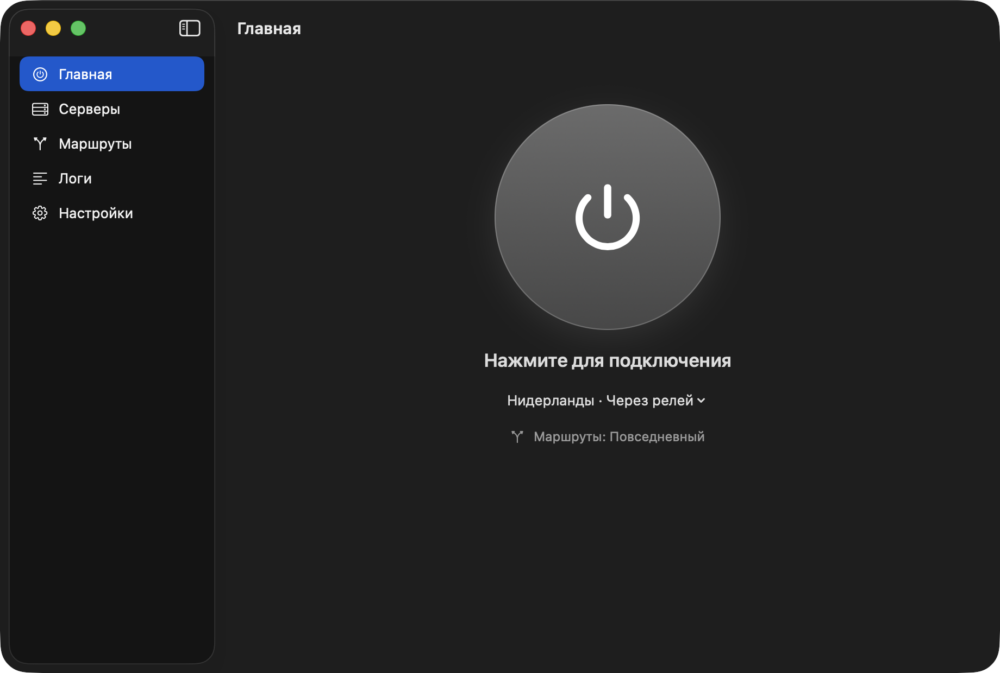
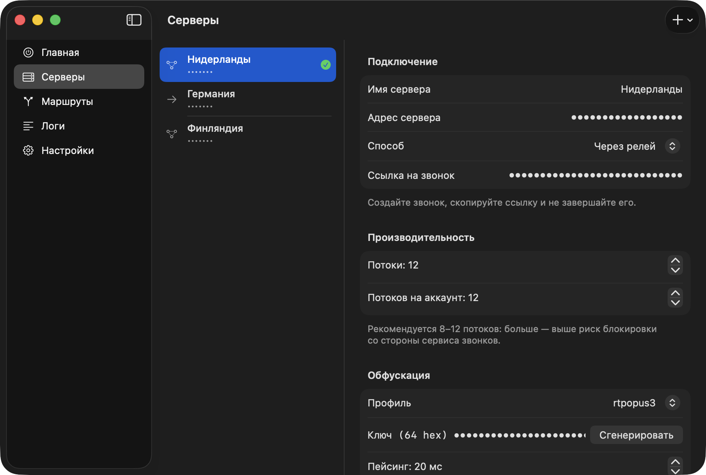
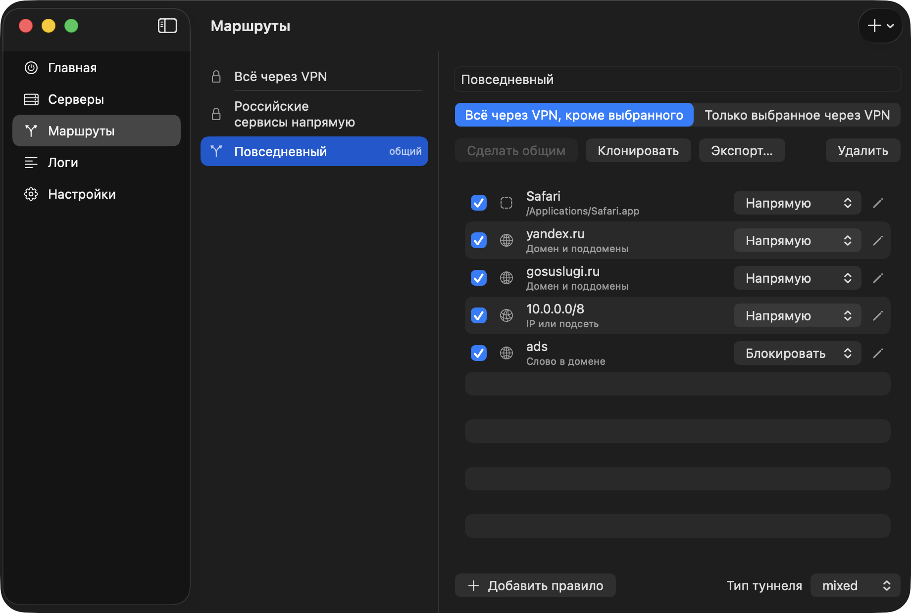
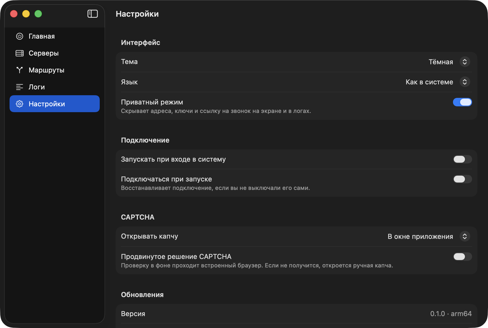

# FreeTurn для macOS

Нативный клиент [free-turn-proxy](https://github.com/hackdiaz-dev/free-turn-proxy) для macOS: системный VPN (WireGuard / AmneziaWG) через TURN-реле звонка или напрямую, с маршрутизацией по приложениям, доменам и подсетям.

## Скриншоты

Сняты в приватном режиме: адреса, ссылки на звонок и ключи скрыты.

| Главная | Серверы |
|---|---|
|  |  |

| Маршруты | Настройки |
|---|---|
|  |  |

## Установка

1. Скачайте DMG со [страницы релизов](https://github.com/huhhuh78787878-collab/freeturn-macos/releases/latest):
   - `FreeTurn-…-arm64.dmg` — Mac на Apple Silicon (M1 и новее);
   - `FreeTurn-…-x86_64.dmg` — Mac на Intel.
2. Перетащите FreeTurn в «Программы».
3. Первый запуск: правой кнопкой по FreeTurn → «Открыть» — приложение подписано без сертификата разработчика.
4. При первом подключении FreeTurn попросит пароль администратора, чтобы установить фоновую службу туннеля.

Дальше приложение обновляется само: при запуске проверяет GitHub Releases, скачивает DMG под процессор
этого Mac, сверяет SHA-256 и перезапускается. Отключается в «Настройки → Обновления».

## Возможности

- Подключение Relay (через звонок) и Direct — как в Android-клиенте.
- Несколько серверов: добавить, клонировать, переименовать, удалить, выбрать активный.
- Импорт `freeturn://`: клик по ссылке, вставка из буфера, QR из файла или с экрана, ручная настройка.
- Маршруты: профили «всё через VPN, кроме…» или «только выбранное через VPN»; правила по приложениям, доменам, ключевым словам и подсетям; действия «через VPN», «напрямую», «блокировать»; импорт и экспорт профилей; встроенный профиль «российские сервисы напрямую».
- Капча: автоматическая в фоне или ручная — в отдельном окне поверх остальных (закрывается само) либо в браузере.
- Скорость, трафик, время сессии, потоки, пинг; логи с фильтрами и файлом на диске; приватный режим.
- Иконка в строке меню, запуск при входе, автоподключение, смена сети и пробуждение без ручных действий.

## Требования

- macOS 14+, Apple Silicon или Intel.
- Для сборки: Go 1.26, Command Line Tools (Xcode не нужен).
- Свой VPS с free-turn-proxy и конфигом WireGuard; для Relay — ссылка на звонок.

## Сборка

```bash
git submodule update --init
make app      # build/FreeTurn.app под архитектуру этой машины
make dmg      # build/FreeTurn-<версия>-arm64.dmg, …-x86_64.dmg и SHA256SUMS.txt
make test     # тесты Go, Swift и скриптов
```

При первом подключении приложение предложит установить фоновую службу (нужен пароль администратора): она поднимает системный туннель. Удалить службу можно в настройках.

## Устройство

| Процесс | Права | Что делает |
|---|---|---|
| `FreeTurn.app` | пользователь | интерфейс, хранение, сборка конфигов |
| `freeturn-core` | пользователь | ядро free-turn-proxy без правок; слушает UDP на loopback |
| `freeturnd` | root (launchd) | запускает движок Amnezia Box: utun, правила, WG/AWG в порт ядра |

Закрыли приложение — туннель снимается сам. Данные: `~/Library/Application Support/FreeTurn/` (права 0600).

## Ограничения

- Нет режима локального порта и TCP-режима для Xray.
- Нет подписок и SOCKS5-раздачи.
- Сборка подписана ad-hoc, без нотаризации Apple.
- Обновление ставит новое приложение, но не фоновую службу: если она сменилась, приложение попросит её переустановить.
- Выдача доступа другим, бэкапы и управление VPS по SSH — следующие этапы, см. [PLAN.txt](PLAN.txt).

## Лицензия

GPL-3.0.
